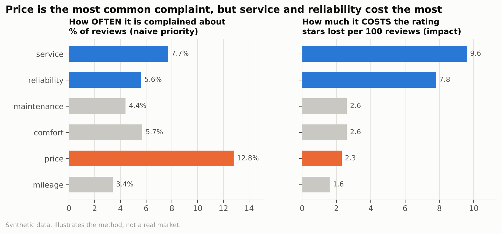
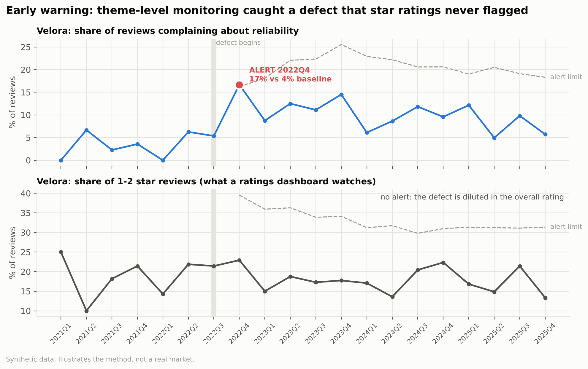

# Automotive Customer Sentiment & Business Intelligence

**The most common complaint isn't the one worth fixing.** End-to-end customer review analytics for a car company:
Python · SQL (SQLite) · NLP · statistics · Power BI

**[▶ Live project page](https://rahulsuxsena1.github.io/Data-analyst/)** · [Insights report](docs/insights_report.md) · [Power BI project](powerbi/) · [SQL](sql/queries.sql)

> ⚠️ **Synthetic data.** Brands, models and reviews are fictional, generated by `src/generate_data.py`.
> The numbers demonstrate the method; they are not facts about a real market.
> [Why synthetic, and how the method was validated →](#how-do-we-know-the-analysis-works)

---

## The finding in one chart



A standard "most frequent complaint" ranking says **fix price first**. A key-driver regression shows a price
complaint lowers a rating by **0.18 stars**, while a service complaint lowers it by **1.25** and a
reliability complaint by **1.39**. Weighted by impact, **service costs about 4× more rating than price**.
Ranking by volume would have sent the improvement budget to the wrong problem.

## The problem

A car company receives thousands of reviews. Reading them by hand is slow and inconsistent, so management
cannot see which problems are most common, which are most damaging, or which are **new**.

## Business questions

| # | Question | Answer (synthetic data) | Where |
|---|---|---|---|
| 1 | Which brands rate lowest, and is the gap meaningful? | Norvik (3.39) and Velora (3.50); confidence intervals confirm the gap is not noise | `q01`, `q02`, `drivers.py` |
| 2 | Which themes dominate 1-2 star reviews? | Service (42%) and reliability (37%) | `q03` |
| 3 | Is sentiment per theme improving or worsening? | Service is worsening, almost entirely at Norvik: 8% → 19% of reviews (2020 → 2025) | `q05`, `q11` |
| 4 | Which theme hurts ratings most? | Reliability (−1.39 stars) and service (−1.25); price only −0.18 | `q04`, `drivers.py` |
| 5 | Do newer model years review better? | Yes, modestly, **except MY2022**: Velora Strato MY2022 is the worst cohort in the market (45% 1-2 star) | `q06`, `q09` |
| 6 | Where should management focus first? | Service, then reliability; **not** price | `q07`, `drivers.py` |

**Full write-up for management: [`docs/insights_report.md`](docs/insights_report.md)**

## What makes this project different

1. **Impact, not just volume.** A regression estimates how many stars each complaint costs, holding other
   complaints and the brand constant. Ranking by frequency × impact reverses the naive priority list.
2. **An early-warning system, with its false alarms reported.** A quarterly two-proportion z-test per
   brand × theme caught a product defect in **its first full quarter**, while the share of 1-2 star
   reviews **never** raised an alert. 606 tests, 5 alerts: 1 real, 4 false. Both numbers are reported.

   

3. **Theme-level sentiment.** Each theme takes the sentiment of its own sentence, so
   *"comfortable seats, but the dealer was rude"* is recorded as comfort +, service − instead of an overall "mixed".
4. **Statistical honesty.** Confidence intervals on every brand average; small brands adjusted for sample size
   (empirical-Bayes shrinkage); model accuracy reported against a majority-class baseline; known weaknesses written down.
5. **Validated against a known answer** (next section).

## How do we know the analysis works?

Real review data has no answer key, so you can never be sure a method missed nothing. With synthetic data
there is one. The generator **planted six business problems** (a deteriorating dealer network, a defective
model-year cohort, a common-but-harmless complaint, and others) and saved the answers in
`data/synthetic_truth/`. **Every analysis script ran without reading it.** At the end, `validate_planted.py`
compares results with the answers:

**9 / 9 planted signals recovered** · theme tagger precision ≈ 99%, recall ≈ 77% → [`docs/pipeline_validation.md`](docs/pipeline_validation.md)

## Method

```
data/raw/reviews.csv ─► clean.py ─► themes.py ─► sentiment.py ─► build_db.py ─► run_queries.py
   12,360 messy rows     11,496 rows  theme + aspect  VADER, TF-IDF   SQLite       12 SQL queries
                                      sentiment       + LogReg        star schema
                         ─► drivers.py ─► early_warning.py ─► powerbi_export.py ─► charts.py ─► validate_planted.py
                            regression,   z-test alerts       Power BI tables      images/      planted-signal check
                            shrinkage,
                            scenarios
```

| Stage | What | Key output |
|---|---|---|
| Cleaning | 3 date formats, brand typos (fuzzy match), `"4 stars"` ratings, HTML junk, exact and near duplicates. Every step logged with row counts | [`docs/cleaning_log.md`](docs/cleaning_log.md) |
| SQL | Normalised schema with a review × theme bridge table; 12 queries using CTEs, `CASE WHEN`, `LAG`, `RANK`, `DENSE_RANK`, `ROW_NUMBER`, rolling windows, confidence intervals | [`sql/queries.sql`](sql/queries.sql), [`docs/sql_results.md`](docs/sql_results.md) |
| Sentiment | Rating-based weak labels; VADER vs TF-IDF + logistic regression on an 80/20 split | [`docs/error_analysis.md`](docs/error_analysis.md) |
| Themes | Keyword dictionary, sentence-level, VADER + car-domain lexicon | `data/clean/review_themes.csv` |
| Drivers | OLS (NumPy) of rating on theme complaints + brand; impact-weighted priority; what-if scenarios | `outputs/theme_priority.csv`, `outputs/scenarios.csv` |
| Early warning | Brand × theme × quarter, two-proportion z-test vs trailing 4 quarters | `outputs/alerts.csv` |
| Dashboard | Star schema, 19 DAX measures, 3 report pages as a Power BI Project (generated, schema-validated) | [`powerbi/`](powerbi/), [`docs/DASHBOARD_GUIDE.md`](docs/DASHBOARD_GUIDE.md) |

### Sentiment model results (held-out test set, n = 2,300)

| Model | Accuracy | Macro-F1 |
|---|---:|---:|
| Majority class ("always positive") | 61.0% | 0.25 |
| VADER (rule-based) | 62.9% | 0.52 |
| **TF-IDF + logistic regression** | **88.5%** | **0.86** |

**Read with care:** labels come from star ratings (weak labels), and synthetic reviews reuse sentence templates,
which inflates text-model scores. Error analysis shows that **at least 40% of the "errors" are label problems**
(misclicks, mixed reviews, lukewarm 3-star reviews) rather than model mistakes.

## Recommendations

1. **Make dealer service the #1 improvement programme**, starting with Norvik and East-region dealers.
2. **Open a quality investigation into Velora Strato MY2022-23.** Complaints point to the transmission.
3. **Monitor complaint themes every quarter**, not just star ratings.
4. **Don't change prices because of reviews.** Price complaints barely move ratings (reviews can't measure the effect on sales).

What-if scenarios with stated assumptions are in the [insights report](docs/insights_report.md#3-what-if-scenarios).

## Dashboard

A 3-page Power BI report, stored as a **Power BI Project** (`powerbi/AutoVoice.pbip`): the data model (TMDL)
and report (PBIR) are plain text, generated by `powerbi/build_pbip.py`, so every measure and visual is
reviewable in git.

| Page | Headline | Contents |
|---|---|---|
| 1 · Overview | *Norvik and Velora trail the market. Service is the main reason.* | 4 KPI cards, 3-month rolling rating trend, sample-size-adjusted brand ranking, slicers |
| 2 · Complaint Themes | *Price is the most common complaint, but service and reliability cost the most rating.* | "How often" vs "how much it costs" bars, brand × theme matrix, theme trend, service by region |
| 3 · Drill-down & Early Warning | *Read the reviews behind the numbers.* | 6 slicers, review table, Velora control chart, alert table |

Star schema: `fact_reviews` → `dim_brand_model`, `dim_date`; `bridge_review_theme` (review × theme) with a
bidirectional filter so a theme slicer filters reviews. 19 DAX measures, including time intelligence
(`SAMEPERIODLASTYEAR`, `DATESINPERIOD`), `REMOVEFILTERS` for correct denominators, and a shrinkage-adjusted rating.

**Open it:** [`docs/DASHBOARD_GUIDE.md`](docs/DASHBOARD_GUIDE.md) (Option A, about 10 minutes), or build it by hand (Option B).

<!-- Add screenshots after opening in Power BI Desktop: images/dashboard_overview.png, dashboard_themes.png, dashboard_drilldown.png -->
_Screenshots will be added after the report is opened in Power BI Desktop._

## Reproduce

```bash
pip install -r requirements.txt
python run_pipeline.py          # about 15 seconds: generates data and rebuilds every output
pytest -q                       # 24 tests: cleaning, tagging, alerts, every SQL query
```

Use a real dataset instead: put it at `data/raw/reviews.csv` and run `python run_pipeline.py --real`
(see [`docs/data_dictionary.md`](docs/data_dictionary.md#switching-to-real-data)).

## Repository layout

```
├── run_pipeline.py            one command runs everything
├── src/                       one module per stage (generate, clean, themes, sentiment, build_db,
│                              run_queries, drivers, early_warning, powerbi_export, charts, validate_planted)
├── sql/                       schema.sql, queries.sql
├── autovoice.db               SQLite database (open with DB Browser for SQLite)
├── data/raw/                  messy synthetic export
├── data/synthetic_truth/      planted answers: read ONLY by validate_planted.py
├── outputs/                   query results, model metrics, alerts, driver tables
├── powerbi_data/              star-schema CSVs for Power BI
├── powerbi/                   Power BI Project: AutoVoice.pbip + semantic model (TMDL) + report (PBIR)
├── images/                    charts
├── docs/                      insights report, cleaning log, data dictionary, error analysis,
│                              validation, dashboard guide, interview prep
└── tests/                     pytest
```

## Limitations

- **Synthetic data.** It proves the method, not the findings. Replace it before quoting any number as fact.
- **Weak labels.** Star ratings are an imperfect stand-in for sentiment.
- **Keyword tagging** misses indirect phrasing (recall ≈ 77%) and sarcasm (VADER reads 69% of sarcastic reviews as positive).
- **Association, not causation.** The regression shows what goes with low ratings, not what causes them.
- **No sales data.** Scenarios estimate rating changes only; no revenue or profit claims are made.
