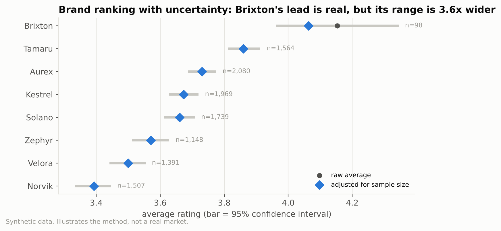
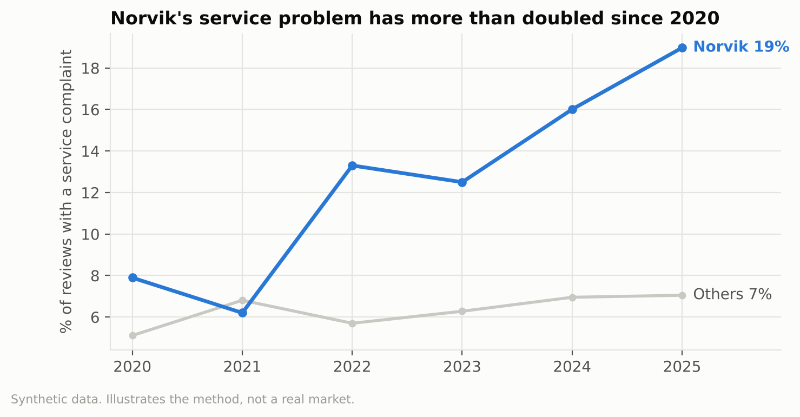
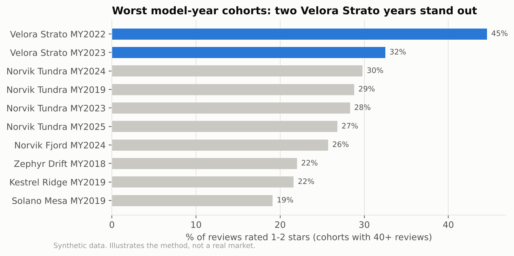
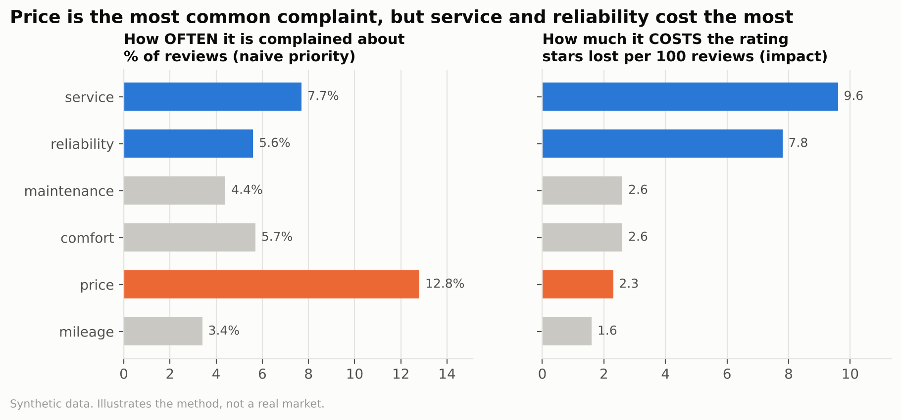
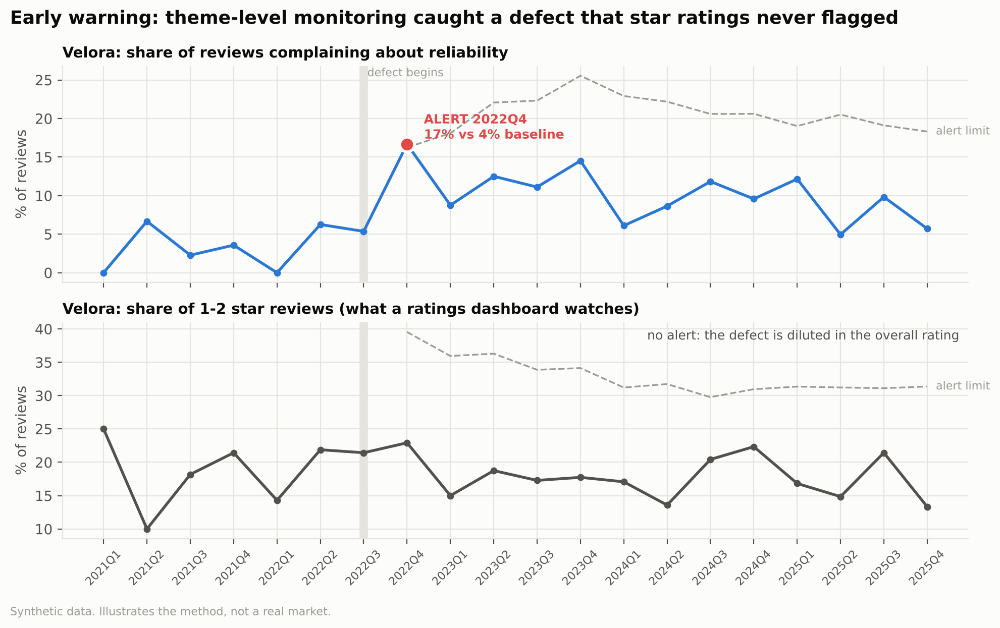

# AutoVoice: management insights report

> **Synthetic data.** All numbers come from a generated dataset of 11,496 reviews of 8 fictional brands
> (2020 to 2025). They show what the analysis produces and how to read it, not facts about a real market.
> Every number is reproducible with `python run_pipeline.py`.

---

## One-page summary

**The question:** customer reviews contain thousands of complaints. Which ones should management fix first?

**The short answer:** fix **dealer service** first, then **reliability**. Price is mentioned the most,
but it hurts ratings the least.

| # | Recommendation | Evidence | Confidence |
|---|---|---|---|
| 1 | **Make dealer service the #1 improvement programme**, starting with Norvik and the East region | Service complaints cost 9.6 stars per 100 reviews, the most of any theme. Norvik's service-complaint rate more than doubled (8% to 19%, 2020 to 2025). East-region dealers: 40% of service mentions negative vs 29% elsewhere | High: effect is large and consistent across brands |
| 2 | **Open a quality investigation on Velora Strato, model years 2022-23** | Worst cohort in the market: 45% of MY2022 reviews are 1-2 stars vs 15% overall. Complaints point to the transmission | High: cohort has 100+ reviews; the pattern matches a production defect |
| 3 | **Monitor complaint themes quarterly, not just star ratings** | The early-warning test flagged Velora reliability in 2022 Q4, the first full quarter after the defect began. The share of 1-2 star reviews **never** triggered an alert | Medium: 4 of 5 alerts were false alarms; alerts should start a review, not a recall |
| 4 | **Don't prioritise price changes on the basis of reviews** | Price is the most common complaint (12.8% of reviews) but costs only 0.18 stars each; fixing 10% of price complaints moves the average by 0.002 stars | High for "low rating impact". Price may still matter for **sales**, which reviews cannot measure |

---

## 1. The six business questions

### Q1. Which brands rate lowest, and is the gap meaningful?

- **Norvik (3.39)** and **Velora (3.50)** are lowest. Their 95% confidence intervals do not overlap
  with the middle of the market (3.61 to 3.78), so **the gap is real**, not noise.
- **Brixton (4.15)** is top but has only 98 reviews. Its interval is 3.6 times wider than a typical brand's.
  After adjusting for sample size (empirical-Bayes shrinkage) it is still #1 at 4.06. The lead is real but its size is uncertain.
- Norvik has the highest share of 1-2 star reviews: **22.3%**, against 11 to 15% for most brands.

### Q2. Which complaint themes appear most in 1-2 star reviews?

| Theme | % of 1-2 star reviews mentioning it |
|---|---:|
| Service | 42.2% |
| Reliability | 36.7% |
| Price | 30.3% |
| Maintenance | 23.0% |

Service and reliability dominate unhappy reviews. (SQL: `q03_themes_in_low_ratings`)

### Q3. Is sentiment on each theme getting better or worse?

- **Service is getting worse, driven by one brand.** Norvik's share of reviews with a service complaint
  went from 8% (2020) to 19% (2025); all other brands stayed at 5 to 7%.
- Norvik fell from 5th to last (7th) in the yearly brand ranking from 2022 onwards (SQL `q11`).
- This is a **slow drift**, and the early-warning test (built for sudden jumps) did not flag it.
  The year-over-year trend query (`q05`) did. Both are needed.

### Q4. Which theme hurts ratings most when mentioned?

Two methods, same conclusion:

| Theme | Simple gap (with vs without complaint, SQL q04) | Regression (other themes and brand held constant) |
|---|---:|---:|
| Reliability | -1.44 | **-1.39** (95% CI -1.47 to -1.32) |
| Service | -1.31 | **-1.25** (-1.32 to -1.19) |
| Maintenance | -0.68 | -0.58 |
| Mileage | -0.52 | -0.48 |
| Comfort | -0.54 | -0.45 |
| Price | -0.27 | **-0.18** (-0.23 to -0.13) |

The regression numbers are a little smaller because unhappy customers often complain about several
things at once; the simple gap counts the same unhappiness twice. (`src/drivers.py`, R² = 0.29)

### Q5. Do newer model years get better reviews?

Yes, modestly. Average rating rises from about 3.55 (MY2015-19) to 3.72 (MY2025), and reliability complaints
fall from 7.5% (oldest three model years) to 4.3% (newest three). **The exception is MY2022**, which
reverses the trend (7.4%) because of the Velora Strato cohort:

### Q6. Where should management focus first?

The project plan proposed **volume × negativity**. That score ranks **price #1**. But a price complaint
costs only 0.18 stars, while a service complaint costs 1.25. Weighting by impact:

> **stars lost per 100 reviews = 100 × (share of reviews with the complaint) × (stars lost per complaint)**

| Theme | % of reviews complaining | Stars lost per complaint | **Stars lost per 100 reviews** | Naive rank | **Impact rank** |
|---|---:|---:|---:|:---:|:---:|
| Service | 7.7% | 1.25 | **9.6** | 2 | **1** |
| Reliability | 5.6% | 1.39 | **7.8** | 4 | **2** |
| Maintenance | 4.4% | 0.58 | 2.6 | 5 | 3 |
| Comfort | 5.7% | 0.45 | 2.6 | 3 | 3 |
| Price | 12.8% | 0.18 | 2.3 | **1** | **5** |
| Mileage | 3.4% | 0.48 | 1.6 | 6 | 6 |

**The most common complaint is not the most damaging one.** Prioritising by volume would have
sent the first improvement budget to the theme with the least effect on ratings.

---

## 2. Early warning

Each quarter, every brand × theme complaint rate is compared with the previous four quarters
(two-proportion z-test, alert at z > 3).

- **Velora reliability:** complaint rate jumped from 4% to 17% in 2022 Q4. **ALERT.**
- In the same quarter, Velora's share of 1-2 star reviews went from 20% to 23%, well inside normal
  variation. **A ratings dashboard would have shown nothing.**
- Why: a defect in one model-year of one model is diluted when averaged across a whole brand's reviews.
  Theme-level monitoring isolates it.

**Honest scorecard:** 606 tests, 5 alerts. 1 was the real defect, 4 were false alarms (about 0.8 would be
expected by pure chance; real data is noisier than the textbook model). An alert should trigger
*someone reading 20 reviews*: cheap to check, expensive to miss.

---

## 3. What-if scenarios

**Assumption:** fixing a complaint gains exactly the regression coefficient for that theme, and nothing else
changes. These are **rating** effects only. No revenue or profit figures are claimed, because none were measured.

| Scenario | Complaints removed | Average before | Average after |
|---|---:|---:|---:|
| Norvik halves negative service reviews | 112 | 3.39 | **3.48** (still last, gap to #6 Velora shrinks from 0.11 to 0.02) |
| Velora Strato MY2022-23 transmission fixed (-70% reliability complaints) | 48 | 2.93 | **3.22** |
| All brands cut negative service reviews 25% | 221 | 3.643 | 3.667 |
| All brands cut negative service reviews 10% | 88 | 3.643 | 3.652 |
| All brands cut negative price reviews 10% | 148 | 3.643 | 3.645 |

Portfolio-wide changes look small because most reviews have no complaint at all. The targeted fixes
(Norvik service, Velora Strato) move their own scope by 0.1 to 0.3 stars, which is where action pays off.

---

## 4. How much to trust this

| Claim | Strength | Main caveat |
|---|---|---|
| Service and reliability cost the most stars | Strong | Regression shows association, not proof of cause |
| Velora Strato MY2022 is a problem cohort | Strong | Root cause ("transmission") is read from text, not verified |
| Norvik service is worsening | Strong | |
| Price matters little | Strong **for ratings** | Reviews say nothing about lost sales |
| Sentiment model 88% accurate | **Weak** | Measured against weak labels on templated synthetic text; expect lower on real reviews |

Pipeline validation: the analysis ran blind to the generator's ground truth and recovered
**9 of 9 planted signals** (`docs/pipeline_validation.md`).

---

## Method notes

- **Cleaning:** 12,360 to 11,496 rows. Every step is logged with counts in `docs/cleaning_log.md`.
- **Themes:** keyword dictionary, applied sentence by sentence; each theme's sentiment comes from its own
  sentence(s) via VADER plus a 30-word car-domain lexicon. Precision about 99%, recall about 77% against ground truth.
- **Sentiment model:** TF-IDF (1-2 grams) + logistic regression, 80/20 stratified split.
  Accuracy 88.5%, macro-F1 0.86, vs VADER 63% / 0.52 and majority-class 61% / 0.25.
- **Key drivers:** OLS of rating on negative and positive theme flags plus brand dummies, written in NumPy so every step is visible.
- **Brand ranking:** empirical-Bayes shrinkage; prior strength estimated from the data (k ≈ 21 reviews).
- **Early warning, how it was designed:** version 1 (model × month p-chart, baseline treated as exact)
  alerted on 27 of 108 series and *missed* the defect, because monthly model-level counts are too small.
  Moving to brand × quarter, requiring at least 150 baseline reviews, and using a two-proportion z-test
  (which accounts for uncertainty in the baseline too) gave 5 alerts including the defect. All versions
  are described here rather than hidden.
